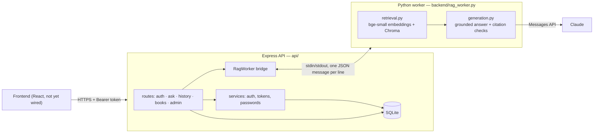

# LorelAI backend report: citations, multi-book synthesis, and the API layer

*November 17, 2026. Covers the 10/30 and 11/6 milestones, plus accounts, admin, and the database.*

> **Updated November 18:** parts of this report have since changed. The current state is in
> [DESIGN_PROCESS.md](../DESIGN_PROCESS.md):
> - The model provider is now OpenRouter's free tier, with Anthropic optional.
> - `/api/history` and the `questions` log were replaced by opt-in saved chats and content-free
>   `ask_events`.
> - The trial, uploads and the website were added.
>
> The MySQL and scaling sections below still apply.

## 1. Summary

LorelAI now has a working backend that a frontend can call over HTTP. One `npm start` runs an
Express API that:

- handles sign-up, sign-in, sessions, and an admin area,
- stores users, question history, and an admin audit log in SQLite, and
- answers `POST /api/ask` with `{answer, citations[]}`. It does this by driving the existing
  Python RAG pipeline, which runs as a long-lived worker process.

| Milestone | Deliverable | Status |
|---|---|---|
| **10/30** Citations + multi-book synthesis | Answers carry real `[Book, p.X]` references. Retrieval pulls from every relevant book, and the model compares them, flagging where books differ. | **Done.** One caveat: "p." is a source record number, not the printed page (§6). |
| **11/6** API layer | `POST /ask` returns `{answer, citations[]}` as JSON, decoupled from the UI | **Done**, in Express as requested (not FastAPI). Lives at `POST /api/ask`. |
| Added: accounts | Sign-up, sign-in, refresh, sign-out, password change, account deletion | **Done** |
| Added: admin | User management, all questions, usage stats, audit log, pipeline control | **Done** |
| Added: database | SQLite now, with a planned path to MySQL | **Done**; migration plan in §7.1 |

**Verification.**

- 87 Python tests pass. Before this work it was 48 passing and 4 failing.
- 64 API tests pass.
- A full end-to-end smoke run passes: real server, real Python worker, real retrieval, real HTTP
  request to the model endpoint.
- The one thing not exercised is a **live** Claude call: this machine has no `ANTHROPIC_API_KEY`.
  The end-to-end run used a local stand-in for the Anthropic Messages API instead (§5). Run
  `npm run smoke` once with a key set to close that gap.

## 2. Architecture



**What happens on `POST /api/ask`:**

1. The API checks the access token, then the user's hourly question limit, then the request body.
2. The bridge sends `{op: "ask", question, k, per_book, book_ids}` to the Python worker, tagged
   with a request ID.
3. The worker embeds the question and retrieves the global top-5 passages plus each book's best 2.
   It drops anything off-topic. If nothing is left, it returns `insufficient` without calling the model.
4. `generation.py` sends the passages to Claude with a JSON schema. It then checks every citation
   ID, quote, and page reference, and retries once with feedback if a check fails.
5. The worker returns the answer with `[Book, p.X]` labels and the citation details.
6. The API saves the question and answer to the asker's history and returns the JSON.

**Why an Express API plus a Python worker, rather than FastAPI?** You asked for Express, and the
pipeline depends on Python-only pieces (sentence-transformers, Chroma's persistent client, the
existing generation code with its tests). Porting it to Node would mean maintaining two copies.

The worker loads the embedding model once, which takes about 15 s. A process per question would
pay that cost on every request. A stdio worker also needs no second port or service to deploy.

All pipeline access goes through one class, [api/src/services/rag/worker.js](../api/src/services/rag/worker.js).
To run the pipeline as its own service later (e.g. FastAPI on a GPU host), you replace that one
class with an HTTP client (§7.2).

## 3. What was built

### 3.1 Citations and multi-book synthesis (10/30)

**`[Book, p.X]` references.** Answers now read like this:

> Feed a three-month-old every three hours during the day. [Holt 1894, p. 40] … every two hours. [Chavasse 1878, p. 12]
>
> The books differ: they give different feeding intervals for a three-month-old. [Holt 1894, p. 40; Chavasse 1878, p. 12]

- The label is the author's surname plus the year, which stays short when several citations stack.
  It handles multi-author credits: "William S. & Lena K. Sadler" becomes "Sadler 1916".
- Full title, author, year, page, chunk ID, and passage text come back in `citations[]`.
- If two chunks from the same page support one sentence, they collapse into a single label.
- When a disagreement spans books, it is introduced as "The books differ"; within one book, as
  "The passages disagree".
- Code: `citation_label()`, `format_citations()` and `to_api_response()` in [backend/generation.py](../backend/generation.py).

**Retrieval across books.** Plain top-k often comes from one or two books, which hides how the
others answer. The new `retrieve_across_books()` in [backend/retrieval.py](../backend/retrieval.py):

- takes the global top-k **plus** each book's best `per_book` passages;
- keeps a passage only if its cosine distance is at most **0.40** and within **0.10** of the best
  match. On this library, relevant passages score about 0.17–0.30 and off-topic questions 0.44 and up;
- always keeps each surviving book's best passage, so trimming to 10 passages never removes a book's view;
- sorts by relevance, so S1 is the best match.

The effect is measurable. For *"Is it good to rock a baby to sleep?"*, global top-3 reaches 3 books
and the new retrieval reaches all 4. In the end-to-end run, *"How often should a three-month-old be
fed?"* retrieved 9 passages spanning all 4 books.

**Synthesis instruction.** A new rule 8 in the system prompt tells the model to combine points the
books share and to treat differing advice as a conflict. Conflicts must cite at least two passages
(this check already existed).

**Fixes made along the way:**

- `retrieve()` now returns `[]` for an empty question and rejects `k < 1`. These were the 4 failing tests.
- The vector store path no longer depends on the working directory.
- With no API key configured, anthropic 2.4 raises a plain `TypeError` that `generation.py` didn't
  catch, so it escaped as `internal_error`. It is now reported as `service_error`, and a test covers it.

### 3.2 The Python worker

[backend/rag_worker.py](../backend/rag_worker.py) loads the models once, then reads JSON requests
from stdin and writes responses to stdout. It supports three operations: `ask`, `books`, and `ping`.

- Requests run on a thread pool (`RAG_CONCURRENCY`, default 4). Retrieval, which is fast and
  CPU-bound, takes a lock; generation, which mostly waits on the network, runs in parallel.
- stdout carries protocol messages only; library output is redirected to stderr.
- Every request gets exactly one response. That includes malformed requests, unexpected exceptions,
  and requests cancelled at shutdown.
- On startup it reports the book catalog and whether an API key is set. The Express side logs a
  warning if no key is set.

On the Node side, `RagWorker` does the following:

- starts the worker and matches responses to requests by ID;
- times out slow requests (120 s by default);
- if the worker crashes, fails its in-flight requests and restarts it with exponential backoff;
- holds new requests while the worker restarts;
- exposes worker state to `/api/health` and the admin pipeline endpoint.

### 3.3 The API (11/6)

The full endpoint reference, with request and response examples, is in [api/README.md](../api/README.md).

| Area | Endpoints |
|---|---|
| Public | `GET /api/health`, `GET /api/books` |
| Auth | `POST /api/auth/signup`, `/signin`, `/refresh`, `/signout`, `/signout-all`, `/change-password`; `GET/PATCH/DELETE /api/auth/me` |
| Asking | `POST /api/ask` |
| History | `GET /api/history`, `GET/DELETE /api/history/:id` |
| Admin | `GET /api/admin/stats`, `/users`, `/users/:id`, `/questions`, `/questions/:id`, `/audit-log`, `/pipeline`; `PATCH/DELETE /api/admin/users/:id`; `POST /api/admin/users/:id/revoke-sessions`, `/pipeline/restart` |

Shared conventions:

- **One error shape:** `{"error": {code, message, details?}, requestId}`, with stable codes.
- **Validation:** zod schemas. Unknown fields are rejected, so you cannot, for example, sign up with `"role": "admin"`.
- **Headers and limits:** Helmet security headers; CORS limited to the Vite dev origin by default;
  32 KB body limit; a request ID on every response and log line.
- **Ask responses:** success and failure share one shape. Pipeline failures map to sensible HTTP
  codes (503 starting up or overloaded, 504 timeout, 502 misconfigured) and always include a
  message that can be shown to the user.

### 3.4 Accounts and security

| Concern | What's in place |
|---|---|
| Password storage | scrypt (built into Node) at N=2¹⁶, r=8, p=2, one of OWASP's recommended settings: about 150 ms and 64 MB per hash. The parameters are stored in each hash, and sign-in upgrades old hashes automatically. |
| Sessions | HS256 JWT access tokens that last 15 minutes, plus opaque refresh tokens stored only as SHA-256 hashes. Every refresh **rotates** the refresh token. |
| Stolen refresh tokens | Presenting an already-used refresh token revokes every session from that sign-in. |
| Instant revocation | Each request reloads the user, one indexed lookup. Disabling an account, changing a role, changing a password, or "sign out everywhere" therefore takes effect immediately (`token_version`). |
| Account enumeration | Sign-in gives one error for a wrong password and an unknown email, and checks unknown emails against a dummy hash so timing doesn't reveal which accounts exist. |
| Brute force and cost | Auth endpoints: 20 requests per 15 min per IP. Questions: 60 per hour per user. Both configurable. |
| Admin safety | Admins can't demote, disable, or delete themselves. The last active admin can't be removed. Every admin action is written to `audit_log` with before and after values. |

### 3.5 Database (SQLite)

The database file is at `api/data/lorelai.db` (gitignored) and is created and migrated on startup.
It uses Node's built-in `node:sqlite`, so there is no native module to compile, with WAL mode and
foreign keys enabled.

| Table | Holds |
|---|---|
| `users` | Email (lowercased, unique), password hash, display name, role (`user`/`admin`), active flag, token version, timestamps |
| `refresh_tokens` | Token hash, session family, expiry, revocation time, user agent and IP |
| `questions` | Every question asked: answer, citations, statements, conflicts, gaps (JSON columns), status, error code, passages retrieved, latency |
| `audit_log` | Who did what to whom, with details |
| `schema_migrations` | Which migration files have run |

Deleting a user also deletes their history and sessions (`ON DELETE CASCADE`).

All SQL goes through a small async interface in [api/src/db/index.js](../api/src/db/index.js)
(`get`, `all`, `run`, `transaction`) using portable SQL. That interface is the seam for the MySQL
move.

## 4. Running it

```bash
# Python side (once)
pip install -r backend/requirements.txt

# API
cd api
npm install
cp .env.example .env        # set JWT_SECRET, ANTHROPIC_API_KEY, ADMIN_EMAIL, ADMIN_PASSWORD
npm start                   # http://127.0.0.1:4000; the pipeline is ready after ~15 s
npm run smoke               # end-to-end check against the running server (1 Claude call)
```

## 5. What was verified

| Check | Result |
|---|---|
| Python tests: `cd backend && python -m pytest testing` | **87 passed.** Before: 48 passed, 4 failed. New tests cover citation labels, multi-book retrieval (all books reached, limits, off-topic cut-off, book filter), the API response shape, the worker protocol (in-process and as a real subprocess), and the missing-credentials path. |
| API tests: `cd api && npm test` | **64 passed**, stable across repeated runs. They cover every auth flow including rotation and reuse detection, validation, rate limits, CORS and headers, ask success and every error mapping, history isolation between users, admin access control and guards, the audit log, and the worker bridge (concurrency, timeouts, crash and restart, startup failure, missing Python). |
| End-to-end smoke | **Passed.** Real Express server, real Python worker, real embeddings and Chroma retrieval, and real generation code making a real HTTP request. The model endpoint was a local stand-in for the Anthropic Messages API (`ANTHROPIC_BASE_URL`), because no key is configured here. The request it received was correct: `claude-opus-5-5`, the JSON schema, rule 8 in the system prompt, and 9 passages from 4 books. The answer came back with `[Holt 1894, p. 18]`-style labels and a "books differ" conflict, was saved to SQLite, and appeared in history. The admin flow (stats, search, disable → instant lockout, delete, audit log) also passed. |
| Not yet verified | A live Claude answer: quality, latency, and token cost. Load testing. Deployment anywhere other than localhost. |

## 6. Known limitations

1. **The "p." numbers are not printed page numbers.** The source files split each Gutenberg text
   into records of about 1,500 characters, and `page` is the record number
   ([backend/text_cleaning.py](../backend/text_cleaning.py) says so). The labels are consistent and
   traceable to the source text, but a reader can't open the physical book to "p. 40". Fixing this
   is the top pipeline task (§7.3).
2. **One worker per API process.** Throughput is roughly `RAG_CONCURRENCY` ÷ average answer time;
   extra questions queue inside the worker.
3. **Rate limits are in memory**, so they reset on restart and aren't shared between instances.
4. **Two browser tabs refreshing at the same moment** will look like token reuse and sign the user
   out. The frontend should send refresh requests one at a time (single-flight). The server could
   instead allow a few seconds' grace.
5. **No email verification, password reset, or OAuth yet.** These need an email provider.
6. **Tokens are returned in the JSON body.** When wiring the UI, consider moving the refresh token
   into an `httpOnly` cookie.
7. **Repository hygiene.**
   - The Chroma database is committed to git, and Chroma writes to `chroma.sqlite3` whenever it
     opens, so the file shows as modified after any run.
   - Compiled `__pycache__` files are tracked. `.gitignore` now covers new ones, but the existing
     tracked files still need a `git rm --cached`.
8. **Citation checks are structural.** They confirm IDs, quotes, and pages exist, not that a passage
   actually supports a claim. This is unchanged from before.

## 7. Next steps

### 7.1 Moving from SQLite to MySQL

SQLite is the right choice for one server and class-project traffic. Move when you run more than
one API instance, need managed backups and point-in-time recovery, or expect many concurrent writes.

**Steps:**

1. **Rewrite `api/src/db/index.js` with `mysql2/promise`.** Repositories and routes don't change.
   - Use a connection pool with `timezone: 'Z'`.
   - `get`/`all`/`run` map to `pool.execute()`. `run` returns `{changes: affectedRows, lastInsertId: insertId}`.
   - `transaction()` checks out a dedicated connection and calls `beginTransaction`, then
     `commit` or `rollback`. Remove the SQLite `PRAGMA`s.
   - Set `isUniqueViolation` on `ER_DUP_ENTRY` (1062).
   - mysql2 returns `SUM`/`AVG` results as strings, so wrap them in `Number()` in `users.counts`
     and `questions.stats`.
2. **Translate the schema**, preferably by adopting a migration tool that supports both dialects
   (Knex, Drizzle, or Prisma). Type mapping:

   | SQLite (today) | MySQL 8 |
   |---|---|
   | `INTEGER PRIMARY KEY AUTOINCREMENT` | `BIGINT UNSIGNED AUTO_INCREMENT PRIMARY KEY` |
   | `email TEXT UNIQUE` | `VARCHAR(254)` with a unique key (index length limits rule out `TEXT`) |
   | `token_hash TEXT UNIQUE` | `CHAR(64)` with a unique key |
   | `role TEXT CHECK (...)`, `status TEXT CHECK (...)` | `ENUM('user','admin')`, `ENUM('answered','partial','insufficient','error')` |
   | `is_active INTEGER` | `TINYINT(1)` |
   | JSON stored as `TEXT` | `JSON` |
   | ISO-8601 `TEXT` timestamps | `DATETIME(3)` in UTC |
   | — | `ENGINE=InnoDB DEFAULT CHARSET=utf8mb4` |

   ```sql
   CREATE TABLE users (
     id            BIGINT UNSIGNED AUTO_INCREMENT PRIMARY KEY,
     email         VARCHAR(254) NOT NULL,
     password_hash VARCHAR(255) NOT NULL,
     display_name  VARCHAR(80),
     role          ENUM('user','admin') NOT NULL DEFAULT 'user',
     is_active     TINYINT(1) NOT NULL DEFAULT 1,
     token_version INT UNSIGNED NOT NULL DEFAULT 0,
     created_at    DATETIME(3) NOT NULL,
     updated_at    DATETIME(3) NOT NULL,
     last_login_at DATETIME(3),
     UNIQUE KEY uq_users_email (email)
   ) ENGINE=InnoDB DEFAULT CHARSET=utf8mb4;
   ```
3. **Timestamps.** Change the single `timestamp()` helper to produce `YYYY-MM-DD HH:MM:SS.mmm` in
   UTC, and convert back to ISO strings in the repository mappers so the API output doesn't change.
4. **Config and data.** Add `DATABASE_URL`, and write a one-off script that copies the SQLite rows
   across. The volume is small.
5. **Tests.** Run the existing suite against a MySQL container in CI as well as in-memory SQLite.

**Alternative worth considering:** PostgreSQL with `pgvector` could hold both the app data and the
embeddings, replacing Chroma. That leaves one database to run.

### 7.2 Scaling

Roughly in the order they'll matter:

1. **Stream answers or make asking asynchronous.** A Claude call takes seconds. Either stream
   tokens to the browser (server-sent events), or return `202` from `POST /api/ask` and let the
   client poll `GET /api/ask/:id` while a queue (e.g. BullMQ on Redis) processes it. This also
   avoids load-balancer timeouts.
2. **Split out the pipeline service.** Wrap the existing `Pipeline` class in `rag_worker.py` with
   FastAPI, run as many replicas as needed (on a GPU host if embedding gets heavy), and replace
   `RagWorker` with an HTTP client that has the same five methods.
3. **Run several API instances.** Sessions are already stateless JWTs. What's left: MySQL (§7.1),
   a Redis store for `express-rate-limit`, and a load balancer with `TRUST_PROXY` set.
4. **Vector store.** Chroma as a local file works for 4 books (2,832 chunks). For a larger library,
   move to Chroma server mode, Qdrant, or pgvector. Make re-indexing a job, and store the book
   catalog in the database.
5. **Cost controls.**
   - Record token usage per question; the API response includes it, and the worker should pass it through.
   - Add per-user daily quotas that admins can configure.
   - Use Anthropic prompt caching for the fixed system prompt.
   - Cache answers for repeated questions with the same book filter.
6. **Observability.**
   - Switch to JSON logs (pino) and pass the request ID through to the worker.
   - Add metrics: latency, error rate by code, worker queue depth.
   - Alert on `errorRate` from `/api/admin/stats`.
7. **Deployment.** Dockerfiles for the API (Node) and the worker (Python), docker-compose with
   MySQL and Redis, HTTPS at a reverse proxy, secrets kept out of `.env` files, and CI running both
   test suites.

### 7.3 Integration

1. **Wire up the frontend.**
   - Replace the scripted `ai_demo.jsx` with real calls to `/api/ask`. The demo currently shows
     modern books that aren't in the library; the real answers will cite the four historical books.
   - Add an auth context with single-flight token refresh.
   - Render `statements[].citationIds` as citation chips with the source text on hover, and
     display `conflicts` and `notCovered`.
   - Add a history sidebar and a small admin dashboard using the existing admin endpoints.
2. **Pick one identity system.** The landing page's waitlist uses Supabase, which is separate from
   these accounts. Either move the waitlist into this database (one table, one endpoint), or switch
   these endpoints to Supabase Auth. Don't run both long-term.
3. **Fill in account features:** email verification, password reset, sign-in with Google, and
   account lockout after repeated failures.
4. **Collect feedback.** Add thumbs up/down per answer, stored against `questions.id`, with an
   admin view, to build an evaluation set.
5. **Improve the pipeline.**
   - Get real page numbers. Gutenberg HTML editions often carry page-number anchors, and Internet
     Archive scans have page-level OCR. Re-extract with those so `p.` means the printed page.
   - Add chapter metadata (the `chapter` field is already passed through).
   - Build a fixed evaluation set of questions with expected sources, and track retrieval hit rate
     when tuning the 0.40 and 0.10 thresholds or adding a reranker.
   - Check that each cited passage actually supports its claim.
6. **API docs.** Generate an OpenAPI spec from the zod schemas (e.g. `zod-to-openapi`) and serve
   Swagger UI.

## 8. Files

**New**

- `api/`: the Express API (source, tests, scripts, `.env.example`, README)
- `backend/rag_worker.py`: the long-running pipeline worker
- `backend/requirements.txt`: pinned Python dependencies
- `backend/testing/test_rag_worker.py`: worker tests
- `docs/backend-report.md`: this report

**Changed**

- `backend/retrieval.py`: `retrieve_across_books()`, `list_books()`, input validation, fixed vector store path
- `backend/generation.py`: `[Book, p.X]` labels, "books differ" conflicts, rule 8, `to_api_response()`, missing-credentials handling
- `backend/testing/test_generation.py`, `test_retrieval.py`: updated assertions plus new tests
- `.gitignore`: Python caches
